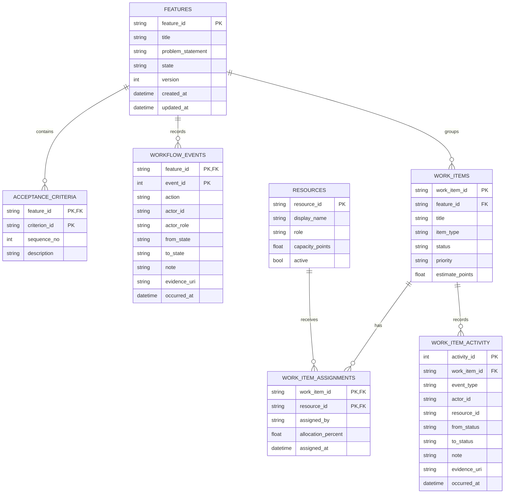

# Database design — M2 local persistence

## Purpose

Persist feature requests, acceptance criteria, workflow transitions, team resources, work items,
assignments, and task activity so project state survives application restarts. The first adapter is
SQLite to keep local setup simple. The repository interface is kept separate from domain rules so
a PostgreSQL implementation can be added for shared deployment.

## Entity relationship view

## Table responsibilities

| Table | Purpose | Important controls |
|---|---|---|
| `features` | One feature request and its current lifecycle state | Stable primary key; state and optimistic version |
| `acceptance_criteria` | Ordered acceptance criteria for a feature | Composite key; unique sequence per feature |
| `workflow_events` | Audit record for each accepted feature transition | Composite feature/event key; actor, role, before/after states and evidence reference |
| `resources` | BA, PO, architect, developer, QA and Scrum resources | Enumerated role; capacity cannot be negative |
| `work_items` | Tasks, defects and test cases linked to a feature | Feature foreign key; constrained type/status/priority |
| `work_item_assignments` | Resource ownership and allocation percentage | Composite key avoids duplicate assignment; allocation is 1–100% |
| `work_item_activity` | Creation, assignment and status-change history | Append-only through the repository API; note and actor recorded |
| `schema_migrations` | Current database schema version | Versioned bootstrap record; future changes need explicit forward migrations |

## Important transaction behavior

A feature transition performs two writes in one SQLite transaction:

1. Append the audit event.
2. Update the feature's state and increment its version.

The repository checks that the database still contains the event's expected `from_state` and event
sequence. This prevents an outdated workflow snapshot from overwriting a newer transition. If the
check or either write fails, the transaction is rolled back.

## Identity and audit boundary

The local CLI accepts actor IDs and roles as command arguments. This is suitable for a local learning
prototype only: it is not authentication. A shared service must derive identity and role from a
verified login/session and authorization store, not trust values sent by a client. Evidence fields
currently store references; they do not yet verify artifact existence, integrity, access, or expiry.

## SQLite versus PostgreSQL

SQLite is the local development database in M2. For multi-user deployment, implement the same
repository contract using PostgreSQL and use database-level permissions, migrations, transaction
isolation, backups, and operational monitoring. Do not point this local prototype at a production
application database.

## M3 requirements and traceability entities

M3 adds the following tables through `migrations/0002_requirements_traceability.sql`:

| Table | Purpose | Key relationship / rule |
|---|---|---|
| `business_requirements` | Current BRD-level requirement and lifecycle status | Stable requirement key; optimistic version number |
| `requirement_versions` | Immutable snapshot of each top-level requirement revision | Composite key `(requirement_id, version_no)` |
| `requirement_clarifications` | BA questions and requester answers | Each clarification belongs to one requirement |
| `user_stories` | BA-decomposed user outcomes | Each story belongs to one business requirement |
| `story_acceptance_criteria` | Individually identified, ordered acceptance criteria | Each criterion belongs to one story |
| `traceability_test_cases` | QA-authored planned tests and automation reference | Stable test-case ID and test level |
| `criterion_test_case_map` | Many-to-many links between ACs and test cases | Composite key prevents duplicate mappings |
| `requirement_events` | Requirement, story, criterion and approval audit trail | Actor, role, transition, note and timestamp |

The approval policy is: BA submission requires no open clarifications, at least one story per
requirement, and at least one AC per story. PO approval requires at least one QA test-case mapping
for every AC. This is planned coverage only; execution results and defects will be linked in M7/M8.

## M4 solution architecture entities

M4 adds these entities through `migrations/0003_solution_architecture.sql`:

| Table | Purpose | Key relationship / rule |
|---|---|---|
| `architecture_packages` | Versioned architecture package for one feature and approved business requirement | Feature/version unique; status is draft, submitted, changes requested, approved or superseded |
| `architecture_artifacts` | Current content for each required architecture section | Unique package/artifact type; records current revision number |
| `architecture_artifact_history` | Previous content for each artifact revision | Append-only revisions preserve the content replaced after reviewer feedback |
| `architecture_decisions` | ADR records with context, decision and consequences | Stable ADR ID and package foreign key |
| `architecture_story_map` | Links all stories under the requirement to the architecture package | Composite key prevents duplicate links |
| `architecture_reviews` | Independent review decisions and evidence references | Reviewer cannot be the package author; approved/changes-requested outcomes |
| `architecture_events` | Package creation, artifact change, story map, submission and review audit | Append-only actor, event, note and timestamp |

The M4 submission gate requires all ten artifact types, at least one ADR, all linked stories mapped,
a PO-approved requirement and a feature in `architecture_review`. The application service then
requires the exact approved package ID in the feature approval event before the developer can start.
The local command-line identity values are still not authenticated; M5 must replace them with a
verified identity and authorization layer.
