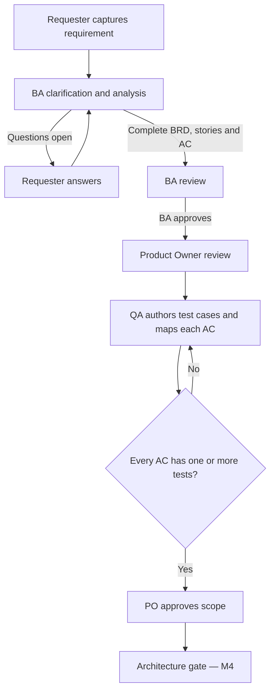
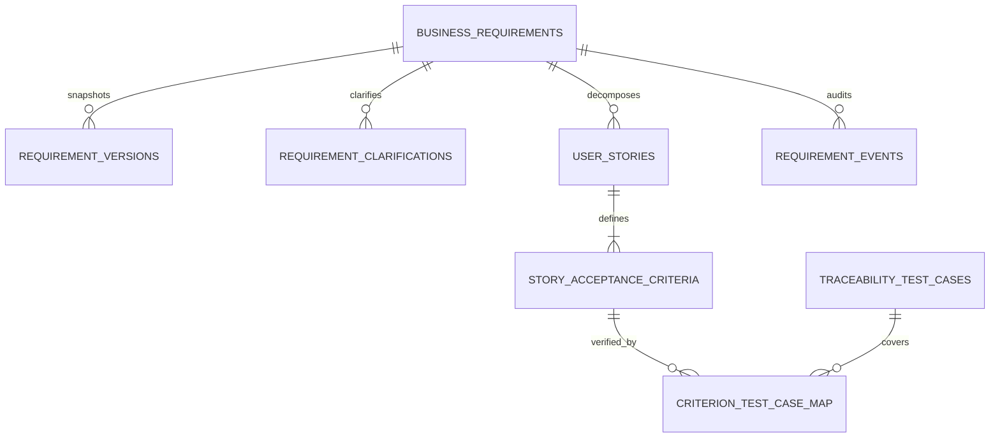

# M3 requirements and traceability architecture

## Lifecycle

## Data relationships

## Deterministic approval rules

1. A requirement must have a non-empty title, description, business value, and supported priority.
2. BA cannot submit while any clarification is open.
3. BA cannot submit a requirement without at least one story.
4. Every story must have at least one acceptance criterion.
5. Only BA can submit or approve BA review; only PO can approve scope or request changes.
6. QA Engineer role is required to create a traceability test case and map it to an AC.
7. QA mappings are editable during PO review only.
8. PO approval is rejected when any AC has zero mapped test cases.
9. PO approval marks the stories approved and locks the approved requirement against direct edits.
10. Requirement edits require a change note, create a complete version snapshot, and can require an expected version.

## Important separation of concerns

The M3 traceability module records planned verification coverage. It does not run the tests or infer
that a test passed. Later QA orchestration will attach test-execution records and defect/evidence IDs.
Similarly, PO approval is not the solution-architecture approval; M4 adds the TDD and architecture
approval gate before development can begin.

## Migration

`migrations/0002_requirements_traceability.sql` adds M3 tables and indexes without changing M2 tables.
The SQLite adapter applies the migration when it detects schema version 1. Re-running initialization
is safe. A PostgreSQL adapter and production-grade migration management are future work.
