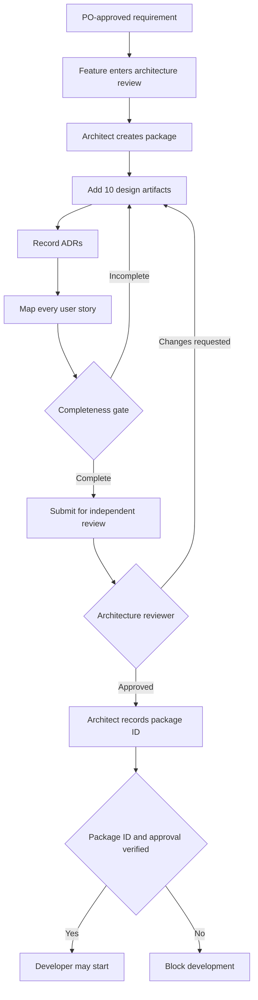

# M4 — Solution architecture and technical-design gate

## Purpose

M4 creates a persisted, versioned design package between Product Owner approval and development. A path or a sentence such as “design approved” is not sufficient. The framework stores the design content, ADRs, story mappings, independent review decisions and audit events.

## Required workflow

1. The feature must be in `architecture_review`.
2. The linked business requirement must be in `approved` status (BA and PO approvals completed, including AC-to-test mapping).
3. An architect creates a package linked to both the feature and the approved requirement.
4. The architect supplies all ten required design artifacts, at least one ADR and a mapping for every user story linked to the requirement.
5. The architect submits the package.
6. A different actor with the `architecture_reviewer` role reviews the package and either approves it or requests changes. The package author cannot approve their own work.
7. An architect moves the feature workflow forward using the approved package ID as evidence.
8. A developer can start only when the feature's recorded architecture-approval event references the currently approved package.

## Ten mandatory artifacts

| Artifact key | Required contents |
|---|---|
| `solution_overview` | Scope, goals, context, assumptions, constraints, system context and quality attributes |
| `component_design` | Components, responsibilities, boundaries, dependencies, interaction and deployment topology |
| `technical_design` | End-to-end design, request/data flows, interface responsibilities, failure paths and non-functional design |
| `database_design` | ER model, entities, attributes, keys, constraints, indexes, transactions, migrations, retention and backup/recovery |
| `api_contracts` | Endpoints, methods, request/response schemas, validation, status codes, authentication, authorization, idempotency and error format |
| `security_threat_model` | Assets, trust boundaries, threats, abuse cases, mitigations, secrets, privacy and security verification |
| `coding_standards` | Language/framework conventions, folder boundaries, naming, error handling, logging, accessibility and review checklist |
| `test_driven_development_plan` | Red-green-refactor sequence, test seams, test data, unit-first boundaries and acceptance-test feedback loop |
| `test_strategy` | Test levels, requirement/AC coverage, environment, test data, automation ownership, quality gates and RAG evaluation where applicable |
| `deployment_rollback` | Environments, configuration, migration order, health checks, rollout, monitoring, rollback triggers and recovery steps |

**Terminology:** `technical_design` is the Technical Design Document. `test_driven_development_plan` describes the Red → Green → Refactor engineering practice. They are separate deliverables and neither substitutes for the other.

An artifact that does not apply to a project must state `N/A` and give a concrete rationale. Empty content, `TBD` and `TODO` are not acceptable evidence. The starter validates presence and a minimal content length; reviewers must still judge technical correctness and adequacy.

## Architecture Decision Records

At least one ADR is required. Each ADR records a stable ID, title, context, decision and consequences. Use additional ADRs for material decisions such as database selection, authentication model, API versioning, eventing, vector search, deployment topology or third-party dependencies.

An ADR is not just a list of technologies. It explains the problem, the considered alternatives, why the selected option was chosen and the trade-offs accepted.

## Story mapping

Every user story associated with the linked business requirement must be mapped to the architecture package. The mapping shows where and how that story is addressed in the design; it does not prove implementation or test execution. Acceptance criteria remain linked to QA test cases through the M3 traceability module.

## Review and change control

- A submitted package is read-only until a review decision is returned.
- `changes_requested` packages can be amended and resubmitted; prior review records remain in the audit history.
- An approved package is immutable. Changes require a new package version and another independent review.
- When a newer package is approved, the previous approved package becomes `superseded`.
- The workflow approval event records the exact approved package ID. Development is blocked if that reference does not match the current approved package.
- Changes to approved business scope must go back through the M3 requirement change process; architecture approval cannot silently rewrite the requirement.

## Role model and prototype boundary

`architect` authors the package. `architecture_reviewer` is a separate review authority, typically a designated senior engineer, architecture council member or human project approver. The initial 12-agent roster has one solution-architect resource, so independent review is a governance approval role and does not silently add a thirteenth autonomous agent.

The CLI accepts actor IDs and roles as arguments. They are demonstration inputs, not verified identities. Production use requires SSO/OIDC identity, server-side RBAC, immutable audit storage, artifact authorization/integrity checks and protected GitHub branch controls.

## Quality gate

The package is ready for independent review only when:

- the linked requirement is PO-approved;
- the feature is in architecture review;
- all ten artifact types exist and contain non-placeholder detail;
- at least one ADR exists;
- every linked user story is mapped;
- the architect records a submission note.

The reviewer must provide a decision note and evidence reference. After independent approval, the architect records the approval in the feature workflow using the exact package ID. Only then may a developer start work.

## Mermaid process

