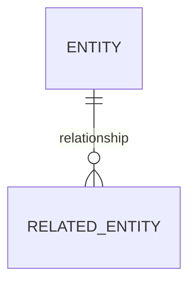

# Database design

## Database engine and rationale

## ER model

## Table and column definitions
| Table | Column | Type | Nullability | Key/constraint | Description |
|---|---|---|---|---|---|

## Relationships, constraints and indexes

## Transaction boundaries and consistency rules

## Data lifecycle, retention and privacy

## Migration, backup and recovery strategy

## Seed/reference data and test-data strategy

## Data access roles and least privilege
